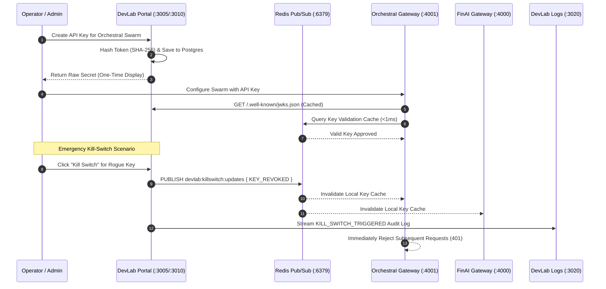

# DevLab Portal — Product Specification, Technical Dossier & Operations Manual

---

## 1. Executive Product Dossier & Market Vision

### 1.1 The Operational Problem Space

As organizations deploy autonomous AI agent swarms and microservices across disparate domains (financial intelligence in FinAI, code orchestration in OrchestraI, autonomous SRE in IncidentAI), security and governance fragment rapidly:

- **Credential Proliferation**: Teams manually issue static API tokens, resulting in unmonitored access keys scattered across dozens of `.env` files.
- **Rogue Agent Containment Failure**: When an autonomous agent enters an unconstrained hallucination loop or exhibits malicious behavior, there is no centralized mechanism to terminate its credentials without restarting production clusters.
- **Compliance & Audit Vacuum**: Organizations cannot prove to SOC2/ISO27001 auditors which human engineer or automated agent initiated a state mutation or external payment transaction.
- **Identity Silos**: Each micro-application implements its own custom authentication, leading to inconsistent JWT signing algorithms, mismatched token expiries, and security vulnerabilities.

### 1.2 The DevLab Portal Value Proposition

**DevLab Portal** serves as the **centralized control plane, tenant identity provider, and API key governance platform** for the entire Yuva DevLab multi-repo ecosystem:

1. **Centralized Application Registry**: Discovers and monitors all ecosystem apps (`finai`, `orchestrai`, `incidentai`, `devlab-logs`) with automated health ping probes and maintenance mode toggles.
2. **Cryptographic API Key Lifecycle Management**: Issues scoped API keys (`dl_live_...`) with rate-limits, budgetary allowances, and automated expiration. Keys are stored strictly as SHA-256 hashes.
3. **Sub-Millisecond Redis Kill-Switch Rail**: Revokes rogue credentials instantly across all distributed gateways via Redis Pub/Sub in **<1ms**, without waiting for database polling cycles.
4. **OIDC & RS256 JWKS Identity Provider**: Emits compliant RS256 JWT tokens and serves the public key discovery endpoint (`/.well-known/jwks.json`) for downstream validation via `@yuva-devlab/auth-server`.
5. **Immutable Tamper-Evident Audit Ledger**: Every key generation, permission change, and kill-switch activation is recorded permanently in PostgreSQL.
6. **Unified Operator Console in Next.js 15**: Modern web interface powered by `@yuva-devlab/ui` for provisioning keys, monitoring live health pings, and tracking token burn rates.

---

## 2. Exhaustive Feature Matrix & Deep Technical Explanation

```
┌────────────────────────────────────────────────────────────────────────────────────────┐
│                              DEVLAB PORTAL CONTROL PLANE                               │
└────────────────────────────────────────────────────────────────────────────────────────┘
                 [Next.js 15 Web Console (:3005)]
                                │  (REST / GraphQL / Socket.IO)
                                ▼
                 [Fastify / NestJS API (:3010)]
                                │
    ┌───────────────────────────┼───────────────────────────┐
    ▼                           ▼                           ▼
[1. App Registry]       [2. Key Manager]            [3. Auth & JWKS]
 • Health Probes         • SHA-256 Hashing           • RS256 Asymmetric Keys
 • Maintenance Flags     • Rate-Limit RPM            • /.well-known/jwks.json
    │                           │                           │
    ├───────────────────────────┴───────────────────────────┤
    ▼                                                       ▼
[4. Redis Kill-Switch Rail]                         [5. Audit Ledger]
 • Redis Pub/Sub (:6379)                             • PostgreSQL (:5432)
 • Sub-1ms Invalidation                              • Immutable Event Log
```

### Feature 1: Centralized Application Registry

- **Module**: `apps/api/src/modules/apps/`
- **Objective**: Maintain a dynamic inventory of all microservices, gateways, and AI agent apps in the ecosystem.
- **How It Works**:
  - Exposes REST endpoints (`GET /api/v1/apps`, `PATCH /api/v1/apps/:id/status`) and GraphQL queries (`apps`, `app(id)`).
  - Periodically polls service health URLs (`/health`).
  - Allows operators to toggle maintenance mode (`isActive: false` with custom maintenance notes), which immediately instructs downstream gateways to display the `AppUnavailableScreen` from `@yuva-devlab/auth-react`.
- **Inputs**: Application metadata (name, slug, originUrl, callbackUrls, healthUrl).
- **Outputs**: Live status indicators, latency metrics, and health states.

### Feature 2: Cryptographic API Key Lifecycle Manager

- **Module**: `apps/api/src/modules/api-keys/`
- **Objective**: Issue and govern secure tenant credentials for API gateways.
- **How It Works**:
  - Generates cryptographically random 32-byte tokens prefixed with `dl_live_`.
  - Computes the SHA-256 hash using Node.js `crypto.createHash('sha256')`.
  - Persists only the hash and a 6-character preview prefix (`keyPrefix: "dl_liv..."`). The raw token is returned exactly once in the creation response.
  - Supports fine-grained scopes (e.g. `agent:execute`, `models:read`, `logs:write`, `audit:read`).
- **Inputs**: `{ name, appId, scopes, rateLimitRpm, expiresAt }`.
- **Outputs**: `ApiKey` database record plus ephemeral `rawKey` string.

### Feature 3: Sub-Millisecond Distributed Kill-Switch Rail

- **Module**: `apps/api/src/modules/redis/`
- **Objective**: Instantly terminate rogue agent operations across distributed nodes.
- **How It Works**:
  - When an operator clicks "Revoke Key" or "Kill Switch" in the console, the API flags the database record `isRevoked: true`.
  - Immediately publishes a revocation message to Redis channel `devlab:killswitch:updates`:
    ```json
    { "type": "KEY_REVOKED", "keyId": "key_102", "hash": "e3b0c44...", "timestamp": 1773001200000 }
    ```
  - Downstream gateways (`orchestrai/apps/gateway`) subscribing to the channel invalidate their in-memory LRU cache in **<1ms**, rejecting subsequent requests with HTTP 401 Unauthorized.
- **Inputs**: Target key ID or tenant ID.
- **Outputs**: Distributed Redis publication and instantaneous gateway eviction.

### Feature 4: OIDC & RS256 JWKS Identity Provider

- **Module**: `apps/api/src/modules/auth/`
- **Objective**: Universal authentication authority for users and service accounts.
- **How It Works**:
  - Generates 2048-bit RSA keypairs via `KeypairService`.
  - Serves public keys in RFC 7517 JWKS format at `GET /.well-known/jwks.json`.
  - Issues RS256 signed JWT session tokens containing standard claims (`sub`, `iss`, `aud`, `exp`, `tenantId`, `roles`).
  - Downstream microservices validate tokens offline using `@yuva-devlab/auth-server` JwksValidator without making network calls per request.
- **Inputs**: User login credentials or service account tokens.
- **Outputs**: RS256 JWT tokens and JWKS JSON public keys.

### Feature 5: Real-Time Socket.IO Cluster Broadcasting

- **Module**: `apps/api/src/modules/websocket/`
- **Objective**: Stream live platform events to administrative dashboards without browser polling.
- **How It Works**:
  - Socket.IO gateway running on path `/events`.
  - Emits real-time events: `app:status_changed`, `key:created`, `key:revoked`, `audit:logged`.
  - Web console subscribes and optimistically updates UI tables in real time.

### Feature 6: Immutable Audit Trail Ledger

- **Module**: `apps/api/src/modules/audit/`
- **Objective**: Permanent compliance recording for enterprise security certifications.
- **How It Works**:
  - Every administrative action triggers an audit interception hook.
  - Inserts an immutable row into PostgreSQL: actor ID, action type (`API_KEY_CREATED`, `KILL_SWITCH_TRIGGERED`), target entity ID, IP address, and JSON diff payload.
  - The API exposes query-only endpoints (`GET /api/v1/audit-logs`); update and delete operations are prohibited at the schema level.

### Feature 7: Administrative Web Portal Console

- **Module**: `apps/web/` (Next.js 15 on port `3005`)
- **Objective**: Unified, accessible control plane user experience.
- **Components**:
  - **`AppCard.tsx`**: Visual card displaying live health status pings and maintenance toggles.
  - **`ApiKeysTable.tsx`**: Scoped keys table with copy-to-clipboard, expiration dates, and revoke triggers.
  - **`ApiKeyModal.tsx`**: Key creation modal with warning modal preventing dismissed uncopied keys.
  - **`KillSwitchModal.tsx`**: Red-themed confirmation dialog requiring confirmation token before triggering emergency kill signals.
  - **`AuditTable.tsx`**: Filterable audit trail viewer with JSON metadata inspect drawer.

---

## 3. How DevLab Portal Interacts with the Multi-Repo Ecosystem



### Detailed Ecosystem Interaction Matrix

| Ecosystem Member    | Direction | Protocol / Transport       | Data Payload / Contract                                                                   |
| :------------------ | :-------: | :------------------------- | :---------------------------------------------------------------------------------------- |
| **`orchestrai`**    | Outbound  | Redis Pub/Sub & JWKS HTTP  | Validates client API keys via Redis cache; intercepts live kill-switch revocation events. |
| **`finai`**         | Outbound  | Redis Pub/Sub & JWKS HTTP  | Enforces tenant quotas and kill-switches on financial agent sessions.                     |
| **`incidentai`**    |  Inbound  | REST API (`:3010`)         | Incident commander requests human approval signatures for P1 mitigation actions.          |
| **`devlab-logs`**   | Outbound  | HTTP POST (`:3020`)        | Streams administrative audit events and security alerts to telemetry storage.             |
| **`devlab-shared`** |  Static   | Internal npm package links | Consumes `@yuva-devlab/ui`, `@yuva-devlab/tokens`, and `@yuva-devlab/logger`.             |

---

## 4. Technical Guidelines & Invariants

### 4.1 Language & Tooling Choices

- **Fastify & NestJS (`apps/api`)**:
  - Fastify engine serves up to 35,000 req/sec with low event-loop overhead.
  - NestJS modular dependency injection architecture separates controllers, resolvers, and domain services cleanly.
- **Next.js 15 App Router (`apps/web`)**:
  - React 19 Server Components for instant server rendering.
  - Clean design system integration using `@yuva-devlab/ui`.
- **Prisma ORM 7 & PostgreSQL**:
  - Strict type inference and schema migrations.
  - Foreign key constraints prevent orphaned keys or disconnected audit trails.

### 4.2 Invariants & Quality Standards

1. **Hard 250-Line Maximum Rule**: Every file across `apps/api/src/` and `apps/web/src/` must remain under 250 lines.
2. **Zero Plaintext Key Storage**: Under no circumstances may plaintext API keys be written to database tables or log files.
3. **Timing-Safe Comparison**: Hashes must be compared using `crypto.timingSafeEqual` to prevent timing attacks.
4. **Sub-50ms Kill-Switch SLA**: Revocation signals must propagate from portal click to Redis within 50ms.

---

## 5. Complete Usage Runbook & Operations Manual

### 5.1 Installation & Database Setup

```bash
# Clone the repository
git clone https://github.com/yuvadevlab/devlab-portal.git
cd devlab-portal

# Copy environment template
cp .env.example .env

# Install dependencies via pnpm
pnpm install

# Run database migrations and generate Prisma client
pnpm db:push
pnpm db:generate

# Start API and Web applications concurrently
pnpm dev
```

### 5.2 API Key Generation via REST API

```bash
# Generate a new API key for OrchestraI
curl -X POST http://localhost:3010/api/v1/api-keys \
  -H "Content-Type: application/json" \
  -H "Authorization: Bearer <admin_jwt_token>" \
  -d '{
    "name": "OrchestraI Worker Pool Key",
    "appId": "app_orchestrai_prod",
    "scopes": ["agent:execute", "models:read", "tools:invoke"],
    "rateLimitRpm": 1200
  }'
```

### 5.3 Triggering an Emergency Kill-Switch via API

```bash
# Revoke a compromised key immediately
curl -X DELETE http://localhost:3010/api/v1/api-keys/key_clx992019 \
  -H "Authorization: Bearer <admin_jwt_token>"
```

### 5.4 Environment Variables Reference

| Variable         | Type   | Default                                                             | Description                                               |
| :--------------- | :----- | :------------------------------------------------------------------ | :-------------------------------------------------------- |
| `PORT`           | Number | `3010`                                                              | HTTP port for Fastify/NestJS Control Plane API.           |
| `PORTAL_ORIGIN`  | String | `http://localhost:3005`                                             | Origin URL for Next.js Web Console.                       |
| `DATABASE_URL`   | String | `postgresql://localhost:5432/devlab_portal_dev`                     | PostgreSQL connection string.                             |
| `REDIS_URL`      | String | `redis://localhost:6379`                                            | Redis connection URL for caching and kill-switch pub/sub. |
| `OIDC_ISSUER`    | String | `http://localhost:3010`                                             | Issuer identifier embedded in generated JWT tokens.       |
| `CORS_ORIGIN`    | String | `http://localhost:3000,http://localhost:3001,http://localhost:3005` | Allowed CORS origins for browser access.                  |
| `SESSION_SECRET` | String | Required in prod                                                    | Cryptographic secret for signing session cookies.         |
