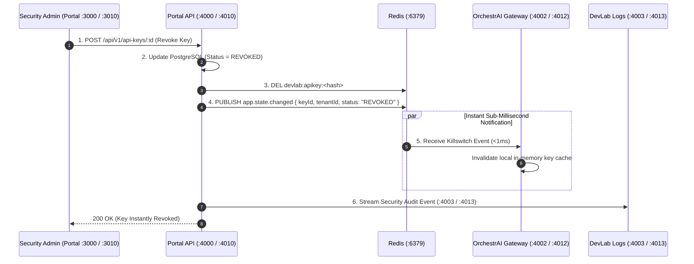

# DevLab Portal — Master Product Specification, Technical Dossier & Operations Manual

---

## 1. Product File: Strategic Vision & Control Plane Mandate

### 1.1 Executive Product Summary

**DevLab Portal** is the centralized developer management platform, API key lifecycle authority, OIDC/JWKS identity provider, and governance control plane for the entire DevLab multi-repo ecosystem (`orchestrai`, `finai`, `devlab-logs`, `vitalai`, `incidentai`).

In a distributed AI and financial services infrastructure, distributed security cannot rely on fragmented, decentralized key validation or slow database queries. DevLab Portal provides:

1. **Cryptographic API Key & OIDC Authority**: Issues cryptographically secure, prefixed API keys (`dl_live_...`, `dl_test_...`) with SHA-256 salted hashes and RS256 signed JWTs discovered via `/.well-known/jwks.json`.
2. **Sub-Millisecond Redis Kill-Switch Bus**: Emits immediate key, user, and tenant revocation signals across a Redis Pub/Sub backplane (`app.state.changed`), guaranteeing that revoked credentials are rejected across all services in <1 millisecond.
3. **Multi-Tenant Organization & RBAC Engine**: Fine-grained role-based access control (`super_admin`, `admin`, `developer`, `operator`, `read_only`, `member`) governing tenant memberships, team invites, and security audit logs.
4. **Platform Usage & Quota Governance**: Centralized token rate-limiting and quota tracking, preventing runaway LLM consumption across tenant swarms.

### 1.2 Target Personas & Primary Use Cases

| Persona                               | Operational Context                                                        | Primary Pain Points Addressed                                                                                             |
| :------------------------------------ | :------------------------------------------------------------------------- | :------------------------------------------------------------------------------------------------------------------------ |
| **Enterprise Security Administrator** | Managing organizational access and revoking compromised credentials        | Needs instant, sub-millisecond global key revocation across all running workers and gateways without restarting services. |
| **Platform / DevOps Engineer**        | Onboarding new developer teams, managing API keys, and setting rate limits | Provides self-service key generation, automated tenant provisioning, and declarative quota management.                    |
| **Compliance & Audit Officer**        | Reviewing access logs, permission shifts, and security compliance          | Requires immutable, cryptographically verifiable audit trails of all key creations, revocations, and role escalations.    |
| **Application Developer**             | Generating test keys and monitoring live service consumption               | Delivers an intuitive Next.js console for generating test/production keys and viewing live request metrics.               |

---

## 2. Exhaustive Feature Directory & Technical Mechanics

```
┌────────────────────────────────────────────────────────────────────────────────────────────────────────┐
│                                   DEVLAB PORTAL TOPOLOGY & CONTROL PLANE                               │
└────────────────────────────────────────────────────────────────────────────────────────────────────────┘
                  [Portal Web Console (Next.js 15 — Dev :3000 | Prod :3010)]
                                        │  (HTTP / WebSocket)
                                        ▼
                  [Portal NestJS Control Plane API (Dev :4000 | Prod :4010)]
                                        │
     ┌──────────────────────────────────┼──────────────────────────────────┐
     ▼                                  ▼                                  ▼
[API Key & OIDC Authority]     [RBAC & Tenant Hierarchy]      [Instant Kill-Switch Pub/Sub]
 • SHA-256 Hashing & RS256 JWKS • Multi-Tenant Isolation       • Redis Channel:
 • Prefixes: dl_live_ / dl_test_• Roles: super_admin/admin/...   app.state.changed
 • Capability Scopes & Quotas   • Audit Log Persistence        • <1ms Propagation SLA
     │                                  │                                  │
     └──────────────────────────────────┴─────────────────┬────────────────┘
                                                          ▼
                                            [PostgreSQL 16 & Redis 7]
```

### 2.1 Application Layer Breakdown

#### 1. Developer Web Console (`apps/web` — Dev: Port `3000` | Prod: Port `3010`)

- **Technology Stack**: Next.js 15, React 19, Tailwind CSS v4, `@yuva-devlab/ui`, `@yuva-devlab/tokens`.
- **Purpose**: Modern administrative web application for tenant, user authentication, and API key lifecycle management.
- **Detailed Features**:
  - **API Key Management Dashboard**: Create, view, copy (one-time display), rotate, and revoke live and test API keys.
  - **One-Click Instant Kill-Switch**: Visual red-alert button allowing immediate eviction of compromised keys or entire tenant access.
  - **Audit Log Explorer**: Filterable, searchable table displaying chronological security events with IP addresses, user agents, and actor IDs.
  - **Tenant & Team Management**: Invite team members, assign granular RBAC roles, and manage billing profiles.
  - **JWKS & OIDC Inspector**: Live introspection interface for cryptographic key rotation and token discovery endpoints.

#### 2. NestJS Control Plane API (`apps/api` — Dev: Port `4000` | Prod: Port `4010`)

- **Technology Stack**: NestJS 11, Apollo GraphQL, Prisma ORM 7, PostgreSQL 16, Redis 7, Socket.IO.
- **Purpose**: High-throughput control plane serving authentication verification, RS256 JWKS token issuance, and GraphQL/REST APIs.
- **Detailed Features**:
  - **OIDC Discovery & JWKS**: Exposes `/.well-known/jwks.json` and `/.well-known/openid-configuration` with RS256 2048-bit keys.
  - **Cryptographic Key Generation**: Generates 32-byte cryptographically secure random bytes encoded in base62, prefixed with `dl_live_` or `dl_test_`. Stores only the `SHA-256` hash in PostgreSQL.
  - **Sub-Millisecond Redis Key Caching**: Syncs key metadata (tenant ID, scopes, status) to Redis, enabling sub-millisecond lookups for downstream gateways.
  - **Kill-Switch Event Publisher**: When a key or app status is revoked, immediately deletes the Redis cache entry and broadcasts a revocation payload to the `app.state.changed` channel.
  - **Comprehensive Audit Trail**: Automatically writes immutable records into the `AuditLog` table for every state mutation.

---

## 3. Inter-System Ecosystem Collaboration ("How It Works With Others")



### 3.1 Inter-Repository Integration Matrix

| Ecosystem Member    | Direction | Protocol & Transport | Exact Payload Contract & Endpoint                                    | Purpose & Operational Behavior                                                                      |
| :------------------ | :-------: | :------------------- | :------------------------------------------------------------------- | :-------------------------------------------------------------------------------------------------- |
| **`finai`**         |  Inbound  | HTTP & OIDC JWKS     | `GET http://localhost:4010/.well-known/jwks.json`                    | Verifies user session tokens; redirects unauthenticated web users to `http://localhost:3010/login`. |
| **`orchestrai`**    |  Inbound  | HTTP & OIDC JWKS     | `GET http://localhost:4010/.well-known/jwks.json`                    | Validates client API keys and user tokens for AI agent execution sessions.                          |
| **`devlab-logs`**   | Outbound  | HTTP POST            | `POST http://localhost:4013/logs`                                    | Streams administrative audit records, access history, and key management actions.                   |
| **`vitalai`**       |  Inbound  | HTTP & OIDC JWKS     | `GET http://localhost:4010/.well-known/jwks.json`                    | Authenticates athlete sessions and verifies trainer role permissions.                               |
| **`incidentai`**    | Outbound  | Webhook HTTP POST    | `POST http://localhost:8085/api/v1/incidents/webhook`                | Dispatches alerts if Redis pub/sub connection drops or database replication delays occur.           |
| **`devlab-guard`**  |  Inbound  | CLI Git Pre-commit   | `uv run devlab-guard scan --path .`                                  | Scans codebase to enforce 250-line rule, type safety, and zero magic strings.                       |
| **`devlab-shared`** |  Static   | npm Package Imports  | `@yuva-devlab/ui`, `@yuva-devlab/tokens`, `@yuva-devlab/auth-client` | Standardized UI components, CSS design tokens, and shared auth client.                              |

---

## 4. Technical Guidelines & Invariant Rules

### 4.1 Prime Non-Negotiable Invariants

1. **Zero Raw Key Storage**:
   - Plaintext API keys are displayed to the user ONCE upon creation and never stored.
   - The database stores only the `SHA-256` hash and a non-sensitive 4-character prefix/suffix hint (e.g. `dl_live_...a8f2`).
2. **Sub-1ms Revocation Propagation**:
   - Every key revocation MUST publish to Redis pub/sub (`app.state.changed`) and delete the corresponding Redis key synchronously within the database transaction.
3. **Hard 250-Line Maximum Rule**:
   - No code file across `apps/*` may exceed 250 lines. Decompose early at 200 lines.
4. **Canonical Enums Only**:
   - All roles (`super_admin`, `admin`, `developer`, `operator`, `read_only`, `member`) must use strict TypeScript enums matching `prisma/schema.prisma`.
5. **Next.js Page & Layout Invariant (Pure SSR Wrappers)**:
   - All `page.tsx` and `layout.tsx` files across Next.js apps MUST remain Server Components (`SSR`). Never mark them `"use client"`.

---

## 5. Developer Usage Guidelines & Operations Manual

### 5.1 Local Prerequisites & Setup

```bash
# Clone the repository
git clone https://github.com/yuvadevlab/devlab-portal.git
cd devlab-portal

# Install dependencies
pnpm install

# Push schema to local PostgreSQL
pnpm db:generate
pnpm db:push

# Start Web (:3000) and API (:4000) in development mode
pnpm dev

# Verify monorepo typecheck
pnpm typecheck
```

### 5.2 Complete Environment Variables Reference

#### API (`apps/api/.env`)

| Variable         | Type   | Default                                                 | Required | Description                                                           |
| :--------------- | :----- | :------------------------------------------------------ | :------: | :-------------------------------------------------------------------- |
| `PORT`           | Number | `4000` (dev) / `4010` (prod)                            |   Yes    | NestJS API control plane port.                                        |
| `NODE_ENV`       | String | `development` / `production`                            |   Yes    | Runtime environment mode.                                             |
| `DATABASE_URL`   | String | `postgresql://...`                                      |   Yes    | PostgreSQL connection string (`devlab_portal_dev` / `devlab_portal`). |
| `REDIS_URL`      | String | `redis://localhost:6379`                                |   Yes    | Redis URL for key caching and WebSocket pub/sub.                      |
| `OIDC_ISSUER`    | String | `http://localhost:4000` (dev) / `http://localhost:4010` |   Yes    | OIDC discovery issuer URL for JWKS tokens.                            |
| `PORTAL_ORIGIN`  | String | `http://localhost:3000` (dev) / `http://localhost:3010` |   Yes    | Frontend origin allowed for CORS and cookie sessions.                 |
| `SESSION_SECRET` | String | (random 32+ char secret)                                |   Yes    | Session cookie encryption secret.                                     |
| `CORS_ORIGIN`    | String | (comma-separated origins)                               |   Yes    | Allowed CORS origins across ecosystem web apps.                       |

#### Web (`apps/web/.env`)

| Variable                            | Type   | Default                                                 | Required | Description                                   |
| :---------------------------------- | :----- | :------------------------------------------------------ | :------: | :-------------------------------------------- |
| `PORT`                              | Number | `3000` (dev) / `3010` (prod)                            |   Yes    | Next.js web application HTTP port.            |
| `NEXT_PUBLIC_DEVLAB_PORTAL_API_URL` | String | `http://localhost:4000` (dev) / `http://localhost:4010` |   Yes    | NestJS backend API URL consumed by client UI. |

### 5.3 Production Operations via DevLab Suite

Production instances are managed through the central `devlab` CLI:

```bash
# Audit environment integrity
devlab env devlab-portal

# Start production services (Web :3010 | API :4010)
devlab start devlab-portal

# Check system-wide platform health
devlab doctor

# Stream production logs
devlab logs devlab-portal
```
