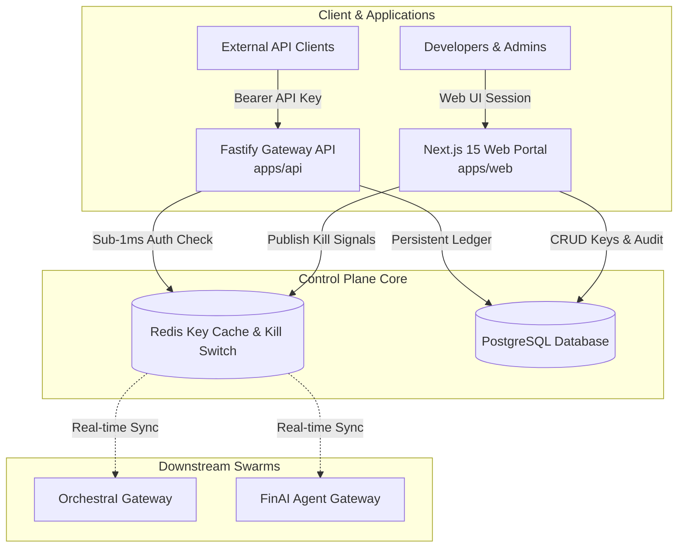

# DevLab Portal — Central Control Plane, API Key Governance & Gateway Management

<p align="center">
  
  
  
  
  
  
</p>

**DevLab Portal** is the centralized control plane, tenant management, and API key governance platform for the DevLab ecosystem. It coordinates authorization, usage quotas, emergency kill-switches, and audit logging for AI agent gateways (OrchestraI, FinAI).

---

## ⚡ Architecture & Components



---

## 🌟 Key Capabilities

1. **Ultra-Low Latency Fastify API (`apps/api`)**:
   - Asynchronous pipeline validating inbound API keys in <1ms.
   - SHA-256 key hashing; zero plaintext key storage.
2. **Sub-Millisecond Redis Kill-Switch Rail**:
   - Synchronizes key revocations across distributed instances via Redis Pub/Sub.
   - Instantly blocks rogue agent sessions without waiting for database polling.
3. **Next.js 15 Developer Portal (`apps/web`)**:
   - Modern dashboard for creating API keys, setting rate limits, and viewing audit trails.
   - Built with `@yuva-devlab/ui` design system components.
4. **Prisma ORM & PostgreSQL (`prisma/`)**:
   - Type-safe schema migrations for tenants, keys, audit logs, and rate limit tiers.

---

## 🚀 Quick Start

### 1. Install & Configure

```bash
# Clone the repository
git clone https://github.com/yuvadevlab/devlab-portal.git
cd devlab-portal

# Copy environment variables
cp .env.example .env

# Install dependencies
pnpm install
```

### 2. Database Migration & Generation

```bash
# Generate Prisma Client
pnpm db:generate

# Push schema to PostgreSQL
pnpm db:push
```

### 3. Run Development Servers

```bash
# Start both Fastify API and Next.js Web Console
pnpm dev
```

### 4. Build & Typecheck

```bash
# Typecheck TypeScript packages
pnpm typecheck

# Build all applications
pnpm build
```

---

## 📁 Repository Structure

```
devlab-portal/
├── apps/
│   ├── api/                    # Fastify high-performance gateway authentication service
│   │   ├── src/routes/         # Auth, keys, audit, and health check routes
│   │   └── src/services/       # Key hasher, Redis cache, and kill-switch manager
│   └── web/                    # Next.js 15 administrative control plane UI
├── prisma/                     # Database schema definitions & migrations
│   └── schema.prisma           # Tenants, ApiKeys, and AuditEvents models
├── .agents/                    # Specialized AI agent definitions
├── .husky/                     # Pre-commit & commit-msg hooks
├── .vscode/                    # VS Code editor settings with watcher exclusions
├── commitlint.config.ts        # Conventional commits configuration
└── turbo.json                  # Turborepo task pipeline configuration
```
